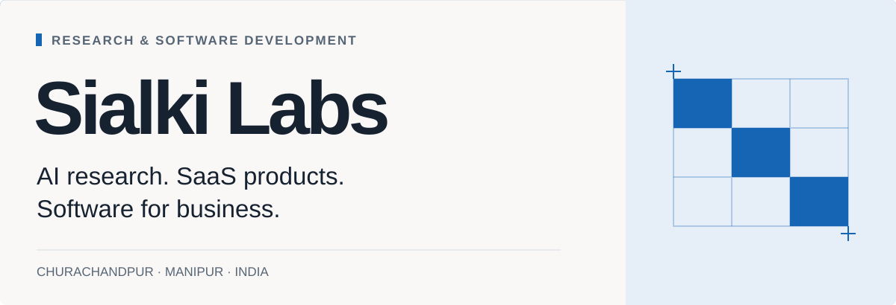

<picture>
  <source media="(max-width: 600px) and (prefers-color-scheme: dark)" srcset="assets/sialki-labs-mobile-dark.svg">
  <source media="(max-width: 600px)" srcset="assets/sialki-labs-mobile-light.svg">
  <source media="(prefers-color-scheme: dark)" srcset="assets/sialki-labs-dark.svg">
  <source media="(prefers-color-scheme: light)" srcset="assets/sialki-labs-light.svg">
  
</picture>

[InMyTongue](#inmytongue) · [Sialki OS Agent](#sialki-os-agent) · [Software development](#software-development) · [Work with us](#work-with-us)

Sialki Labs develops AI products and custom business software. Our principal initiative, InMyTongue, combines research into languages with extremely limited digital resources with the development of AI conversation, web translation and cultural media.

We also maintain Sialki OS Agent, an MIT licensed project for configuring AI workspaces and developing controlled agent workflows.

[Company website](https://sialki.com) · [Research initiative](https://inmytongue.org)

## InMyTongue

InMyTongue’s mission is to build a global living repository for underrepresented languages and a shared digital platform for the communities that speak them. Its scope includes extremely low resource languages and dialects spoken by communities with fewer than 10,000 people.

Research and early product development begin in Northeast India. The wider ambition is international: to document language resources, histories and cultural knowledge that are absent from, or difficult to find on, the public internet, and make them accessible through agreements with the people who hold that knowledge.

The platform will give community members tools for everyday communication and creative work, while allowing visitors to explore their languages and cultures.

### Research that informs the technology

Written records, field research, speaker knowledge, translations and recordings will form the research base. We seek collaboration with elders, language specialists and literature societies to document vocabulary, grammar, pronunciation, tone and cultural meaning.

The work includes recovering expressions that are disappearing from use and developing terminology where communities identify a need. Recovered expressions and newly agreed terms must remain distinguishable in the record.

Our ambition is to compete in global AI development while delivering practical tools for communities sustaining endangered languages. The research will inform language adaptation and training, with separate permissions for collection, publication, commercial reuse and model development.

### AI conversation and web translation

The chat service will combine text and voice interaction, internet search and models adapted to individual languages and dialects. Users will be able to ask questions, find information and communicate in their own languages. A general purpose mode will extend the service beyond the initial language communities.

A companion browser extension will translate website content within the page being viewed. Reusable extension code will be released separately from the hosted translation service, which may require a subscription.

### Creative tools and cultural media

Creators will be able to generate images from text, produce video from images and prompts, and use dubbing and subtitling for regional language content.

Live television and on-demand programming will sit alongside documentaries, oral traditions and heritage collections. This brings contemporary media and cultural records into the same service, giving audiences a way to encounter a language through both everyday use and the histories of its communities.

Content acquisition, archive access and distribution will depend on agreements with contributors, creators and rights holders.

### Commercial services and open source

The business model combines free base access with paid AI and translation services, creator subscriptions, media access and institutional API services. Institutional development will focus on native language communications for telecommunications providers, healthcare organisations and public agencies.

We will release selected reusable software components as open source. Each repository will identify the code covered and its license. Hosted services, private product components, recordings and cultural resources will have separate terms. A software license does not grant rights to community material.

[Explore InMyTongue](https://inmytongue.org) · Product domain: **inmytongue.si**

## Sialki OS Agent

[SIALKI-OS-Agent](https://github.com/SialkiLabs/SIALKI-OS-Agent) provides a local workspace for project instructions, model assignments and specialist configuration. Its public codebase includes saved settings and offline previews. Live AI connections, specialist execution and application control are still to be built.

Three modes define how the agent will work:

| Mode | Purpose |
| :--- | :--- |
| REST | Direct conversation with one selected AI model. |
| LOAD | Research, analysis, writing, planning and learning. Separate deliverables can be created without overwriting existing project assets or controlling applications. |
| CHARGE | Authorized execution across software, infrastructure and creative production, with action limits, review, checkpoints and verification. |

Authorization belongs to each task. Selecting a mode does not authorize external actions or spending.

The repository is licensed under MIT and welcomes contributions.

[Setup and capabilities](https://github.com/SialkiLabs/SIALKI-OS-Agent#run-locally) · [Architecture](https://github.com/SialkiLabs/SIALKI-OS-Agent/blob/main/docs/PRODUCT.md) · [Contributing](https://github.com/SialkiLabs/SIALKI-OS-Agent/blob/main/CONTRIBUTING.md)

## Software development

Sialki Labs welcomes commissioned development of SaaS products, websites, mobile and TV applications, workflow automation and custom AI software.

Each project starts with its users, the work they need to complete and the systems the software must connect to. Development, integration, hosting and ongoing support can be scoped separately.

[Discuss a software project](mailto:hello@sialki.com?subject=Software%20Development%20Enquiry)

## Work with us

We welcome research collaborators, technology partners, sponsors and prospective investors.

Research partnerships can cover source documentation, translation, linguistic review and the preparation of approved training resources. Technical collaboration can support software development, computing resources and media workflows.

Grant and sponsorship discussions can focus on defined research activities, equipment or development work. Investment discussions can address the commercial products and facilities needed to build the business. Each engagement will establish its scope, responsibilities, funding terms and permissions.

| Enquiry | Contact |
| :--- | :--- |
| Software development and general enquiries | [hello@sialki.com](mailto:hello@sialki.com) |
| Research, partnerships, grants and sponsorship | [partner@sialki.com](mailto:partner@sialki.com) |
| Investment | [invest@sialki.com](mailto:invest@sialki.com) |
| Founder contact | [founder@sialki.com](mailto:founder@sialki.com) |

Sialki Labs is based in Churachandpur, Manipur, India. Company incorporation is in progress, and the Guwahati office is expected to open in early 2027.

Founded by George AK Neihsial.
