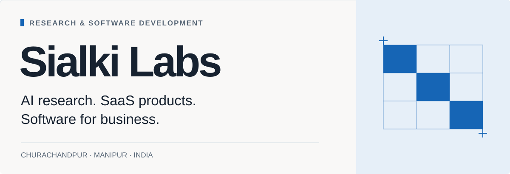

<picture>
  <source media="(max-width: 600px) and (prefers-color-scheme: dark)" srcset="assets/sialki-labs-mobile-dark.svg">
  <source media="(max-width: 600px)" srcset="assets/sialki-labs-mobile-light.svg">
  <source media="(prefers-color-scheme: dark)" srcset="assets/sialki-labs-dark.svg">
  <source media="(prefers-color-scheme: light)" srcset="assets/sialki-labs-light.svg">
  
</picture>

[Software development](#software-built-around-business-requirements) · [InMyTongue](#inmytongue-a-global-purpose-a-local-beginning) · [Support the research](#support-inmytongues-development) · [Contact](#start-a-conversation)

Sialki Labs is a privately owned AI and software technology business founded by **George AK Neihsial**, with operations in **Churachandpur, Manipur, India**.

We develop our own products and welcome commissioned development of websites, mobile and TV applications, AI-enabled tools, and business software. Our research focuses on problems that require field knowledge and specialist understanding before technology can address them.

## Software built around business requirements

Sialki Labs’ commercial work extends beyond InMyTongue.

We welcome enquiries for **SaaS products, websites, mobile applications, TV applications, workflow automation, and custom AI software**. Each engagement begins with the people who will use it, the task it must accomplish, and the requirements for delivery and maintenance.

**[Discuss a software project →](mailto:hello@inmytongue.org?subject=Software%20Development%20Enquiry)**

---

## InMyTongue: a global purpose, a local beginning

**InMyTongue is Sialki Labs’ language research and development initiative for underrepresented communities worldwide.** Initial work begins in Northeast India, with the intention to extend the approach to communities elsewhere through local participation and collaboration.

The project focuses on extremely low-resource languages and dialects, including those spoken by communities with populations below 10,000. Population size should not determine whether a language receives serious research or useful technology.

### A language needs more than a recording

Vocabulary, grammar, pronunciation, and cultural meaning cannot be recovered through voice collection alone. Some knowledge survives in handwritten records. Some remains with elders. Some expressions are disappearing from everyday speech before their meaning has been documented.

InMyTongue’s intended work brings these sources together through field research, recovery, and community review.

We aim to work with elders, language specialists, and literature societies to document what survives, recover what can still be recovered, and develop terminology where communities identify a need. Recovered expressions and newly agreed terms must remain distinguishable in the record.

**Initial collection is underway through physical notes and copies gathered by individuals and small teams.** Digitization and translation have not yet begun.

### Research that returns to everyday life

InMyTongue is being developed to carry reviewed language resources into tools for learning, communication, access to knowledge, and creative expression.

Its intended model combines **MIT-licensed software with a subscription-based hosted service**. Language data is intended to remain proprietary and separate from the software license, subject to contributor and community agreements that establish ownership and permitted uses.

**[Explore InMyTongue →](https://inmytongue.org)**

---

## Support InMyTongue’s development

Field collection has begun. Funding is needed to sustain that work and begin digitization, translation, language review, and further software development.

InMyTongue welcomes **research collaborators, technology partners, sponsors, donors, and investors** interested in advancing language research and technology for underrepresented communities.

Support may include funding, language expertise, equipment, computing resources, or software engineering. Contributions can address a defined part of the project, with scope, responsibilities, and permissions agreed in advance.

**[Discuss research, partnership or sponsorship →](mailto:partner@inmytongue.org?subject=InMyTongue%20Research%20and%20Development)**

## Start a conversation

| Enquiry | Contact |
| :--- | :--- |
| Software projects and general enquiries | [hello@inmytongue.org](mailto:hello@inmytongue.org) |
| Investment | [invest@inmytongue.org](mailto:invest@inmytongue.org?subject=Investment%20Enquiry) |
| Research, partnerships and project support | [partner@inmytongue.org](mailto:partner@inmytongue.org) |
| Direct founder contact | [founder@inmytongue.org](mailto:founder@inmytongue.org) |

**George AK Neihsial** · Founder, Sialki Labs
